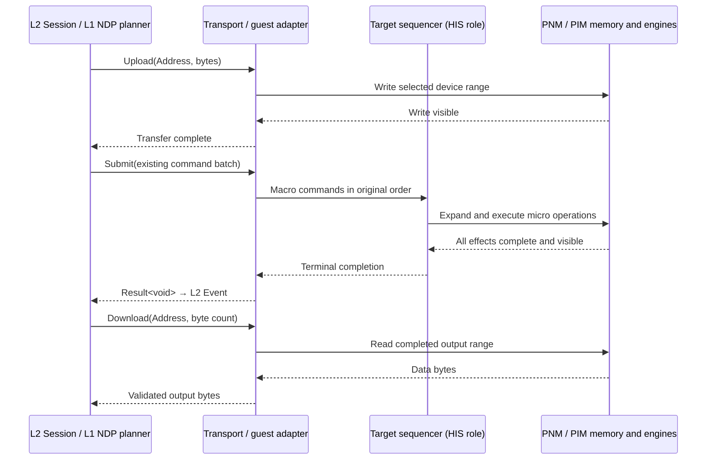

# NDP–gem5 communication specification, version 1

**Status: proposed target-integration contract, grounded in the implemented F1–F5
protocol.** Existing wire fields below are already implemented. Binding them to
a PNM/PIM-enabled gem5 target, and target quiescence on failures, are not implemented
or validated. This specification does not claim AiMX SDK binary compatibility.

Execution planning and physical placement are specified first in the
[execution/layout contract](execution-layout-spec.md). This document addresses
transport of the resulting commands; it does not choose tensor tiling.

## 1. Architectural decision

Use **one ordered command submission interface for transfers, PIM and PNM**.
The host library decides layouts, tiling, addresses and macro-command order. The
gem5 target consumes those commands, expands them into device actions and reports
completion after their memory effects are visible. It must not rebuild Tensor
metadata, infer an operation or generate another KernelPlan.

The communication contract has two separate parts:

1. **Library-facing protocol:** reuse the implemented `NIP1` execution envelope
   and `NDP1` command encoding, without a second metadata format.
2. **Target binding:** translate address-space accesses and submitted commands to
   the existing control interface of the PNM/PIM-enabled gem5 fork. This binding
   must identify actual entry points, address ranges and completion/quiescence
   mechanisms before it can be implemented.

A stock-FS socket receiver remains the reference implementation, not the final
hardware interface. An IPC relay is optional. The contract may be implemented
by direct guest control calls when the target already exposes them; it does not
require adding a new gem5 MMIO device, register map or driver.

## 2. What the AiMX material establishes

The following observations refer to **AiMX Platform Whitepaper**, PDF page numbers:

| Evidence | Consequence for this contract |
| --- | --- |
| pp. 7, 10–11, Figs. 3-3, 4-3, 4-4: host macro instructions reach HIS; HIS expands and multicasts micro instructions; AiM controllers issue DRAM commands | Host sends macro commands. Micro expansion and timing belong below the transport. |
| p. 13, §5.1: QDMA transfers host/device memory; the driver manages host, AiM and GPR allocations | Separate data movement, allocation ownership and instruction execution. Do not send Tensor objects as allocation requests. |
| pp. 13–14, Fig. 5-3: INST, CFR, GPR and AiM occupy distinct address regions; direct CPU access and DMA access differ | Preserve the roles of command ingress, configuration, local storage and bank memory. Do not assume all device bytes are CPU-mappable. |
| pp. 14–15, Fig. 5-4 and §5.2: runtime forms jobs/bundles; driver submits jobs in order and observes completion | Reuse Session ordering and transport completion rather than creating a second tensor scheduler in gem5. |
| p. 22, Fig. 5-17: the emulator separates control-hub and AiM models | Separate command decoding/sequencing from the memory/compute model. |

The earlier **AiM FPGA Software Whitepaper**, PDF pp. 4 and 8, similarly describes
ISR expansion through AiM DMA and runtime-owned weight layout/instruction generation.
Its DMA terminology is related architectural background; AiMX uses HIS/control-hub
terminology. These sources do **not** establish our FP16 profile, PNM extension
opcodes, exact completion register fields, reset guarantees or gem5 physical
addresses. Those are project decisions or target requirements below.

The AiMX figure's MAC example uses a macro iteration count of 64, expanded into
micro commands. Preserve a positive semantic burst count here. Do not infer a
vendor bit encoding or universally apply count-minus-one.

## 3. Responsibility and lifecycle



Baseline: one device, one exclusive context, one outstanding request, one ordered
stream. PNM and PIM share that context and backing memory. Do not add multi-device
routing, out-of-order queues or an extra L2 worker to version 1.

- `Hello` opens a fresh execution context after geometry/profile validation.
- Upload/Download/Submit reuse persistent memory, GPR, GB and MAC state.
- One Submit is a **job**, containing a bounded macro-command batch.
- A series of jobs follows existing Session dependencies/FIFO ordering. Version 1
  adds no serialized job-bundle descriptor or redundant dependency list.
- `Close` ends the context after quiescence; it is not a per-kernel EOC command.
- Closing/reopening cannot resume old allocations or work. No automatic replay.

Request identity is `(epoch, sequence)`. It already exists in the frame header;
do not introduce a duplicate job ID field. Sequence starts at 1 for Hello and
advances once per request, including acknowledged failures. A new connection
uses a new epoch. IDs are correlation tokens, not authorization credentials.

## 4. Memory and address contract

### 4.1 Address types

`DeviceAddress = {space:u8, offset:u64}`; offset is a byte offset within the selected
logical space. It is never a host pointer, guest virtual address or allocation handle.

| Space ID | Meaning | Size |
| --- | --- | --- |
| 1: Shared | Common PIM bank memory, directly usable by PNM | channels × banks × rows × row_bytes |
| 2: Gpr | Shared local/register storage, directly usable by PNM | gpr_bytes |
| 3: Scratchpad | PNM working storage | scratchpad_bytes |

GB uses space ID 4 only as a Transfer destination. Shared or GPR can supply one channel per Transfer. Encode the destination offset as channel × gb_bytes + local_offset. Both offsets and the positive byte count are 32-byte aligned and the range must fit one channel. PIM accumulator registers are accessed by PIM
commands. INST and CFR are **control-interface roles**, not Tensor memory spaces
or new IDs in this protocol. Scratchpad is a project PNM extension, not an AiMX
memory-map claim.

The mapping-ID-1 shared offset is:

```text
offset = (((row × channels) + channel) × banks + bank) × row_bytes + byte_in_row
```

Row zero remains library-reserved zero storage. Both PNM accesses and PIM bank
operations must resolve to the same backing bytes. No separate unsynchronized
PNM/PIM copies are permitted. A target with a different bank mapping must expose
a compatible logical view or require a new mapping/profile and corresponding L1
layout implementation; silently accepting mapping ID 1 is invalid.

### 4.2 Allocation ownership

Retain the current L1 handle→Region allocator. It allocates whole row stripes in
Shared memory and sends no Allocate/Free message. The target reserves the entire
configured region for this context before accepting Hello. GPR/scratchpad are
context resources, not independently allocated per operation in version 1.

AiMX's actual SDK driver allocator is **not copied** into the initial single-device
protocol. If the target already has an allocator, it reserves a whole arena for
this adapter; two allocators must not independently allocate overlapping rows.
The adapter maps logical offsets to that arena. Device release occurs only after
all accesses are quiescent. Data is not implicitly cleared on region reuse.

All ranges must pass overflow, extent, route and command-specific alignment checks.
Byte counts/offsets are bytes; PNM Operand counts are FP16 elements; MAC column
and burst fields count 32-byte bursts. FP16 accesses require 2-byte alignment;
stricter command-specific constraints remain those of the current emulator.

### 4.3 Target binding record (required before implementation)

This is startup configuration, not per-operation metadata. Record:

- Target repository commit and FS configuration path.
- Logical-space sizes, exclusive context ownership and mapping ID.
- Actual device base/extent or control-API resource handle for each space.
- Existing instruction ingress entry point (INST/HIS role) and its payload rules.
- Existing configuration path (CFR role), if any; validate configuration at startup.
- Data transport mechanism and host-buffer pinning/cache-maintenance requirements.
- Completion observation and visibility mechanism.
- Device stop/drain/reset mechanism, including acknowledgement of quiescence.

Do not use the AiMX card's published physical addresses as gem5 addresses by
assumption. Do not choose an arbitrary BAR/CFR layout while the fork is unknown.
These fields are the remaining platform binding, not gaps in Tensor metadata.

## 5. Data/control requests: reuse execution protocol v1

All scalar wire fields are little-endian. Version 1 requires little-endian FP16
binary16 tensor bytes as well; existing little-endian native/FS execution satisfies
this. No float conversion or tensor-payload byte swapping is performed.

### 5.1 Outer frame

| Offset | Bytes | Field |
| --- | --- | --- |
| 0 | 4 | ASCII `NIP1` |
| 4 | 2 | Frame version = 1 |
| 6 | 2 | Kind: request=4, completion=5, error=6 |
| 8 | 8 | epoch |
| 16 | 8 | sequence |
| 24 | 4 | Payload length |
| 28 | 4 | Payload CRC32 (existing codec implementation) |

No extra native struct padding is transmitted. The payload limit is 8 MiB.
Header identity/length and payload CRC must be checked before dispatch. F2
Accepted/Rejected frames are not execution acknowledgements.

### 5.2 Payloads

| Opcode | Request fields, in wire order | Completion |
| --- | --- | --- |
| Hello 1 | op:u8, codec_version:u16=2, numeric_profile:u16=1, mapping_id:u16=1, seven sizes:u64 | Exact request echo |
| Upload 2 | op:u8, address:9 bytes, bytes:u64, byte data | op:u8 only |
| Download 3 | op:u8, address:9 bytes, bytes:u64 | op:u8 followed by byte data |
| Submit 4 | op:u8, NDP1 batch | op:u8 only |
| Close 5 | op:u8 | op:u8 only, after quiescence |

The seven Hello sizes are channels, banks, rows, row_bytes, gb_bytes, gpr_bytes,
scratchpad_bytes. They describe the whole device, not individual tensors.
Require an exact match; do not silently clamp sizes or change a layout.
Hello currently carries no capability bitmap. A conforming baseline target must
support the required command subset below or reject initialization based on its
configured profile. A capability-negotiation extension needs a separate protocol
revision; do not reinterpret v1 Hello trailing bytes.

Upload success means data is visible to the next command, not just that a DMA was
submitted. Download contains actual bytes, not a device pointer. Upload data is
limited to 8 MiB−18, Download data to 8 MiB−1, Submit encoding to 8 MiB−1.
Automatic multi-frame transfer splitting is outside this version.

## 6. Command batch schema and PNM extension

### 6.1 NDP1 layout

```text
magic[4]="NDP1", version:u16=2, fp16_profile:u16=1,
whole_batch_bytes:u32, command_count:u32
repeat command_count times:
    opcode:u16, reserved:u16=0, body_bytes:u32, body[body_bytes]
```

`body_bytes` excludes the 8-byte record header. There is no padding between records.
Maximum command count is 65,536. Reject unknown opcodes, nonzero reserved fields,
truncation, trailing bytes, invalid enum/bool values and length/count overflow.

Notation: `A` is the 9-byte Address; `O` is `A + elements:u64`; sizes/masks below
are u64 unless marked otherwise. Float values are IEEE binary32 bit patterns.

| Opcode | Command | Body fields in order |
| --- | --- | --- |
| 1 | Transfer | source:A, destination:A, bytes |
| 2 | InitializeMac | channel_mask, bank_mask, gpr_offset |
| 3 | Unused in command codec v2 | — |
| 4 | MacAllBanks | channel_mask, row, burst_column, burst_count |
| 5 | ReadMac | channel_mask, gpr_offset |
| 6 | LaunchPnmProgram | program, arguments:A, argument_bytes, stack:A, stack_bytes, instruction_limit |
| 7 | PnmCompute | kernel:u16, input_count:u32, inputs:O[], output:O, rows, width, inner, transpose_b:u8, factor:f32, epsilon:f32, index_count:u32, indices:u64[] |
| 8 | PnmRelayout | source:A, destination:A, rows, columns, banks, tile_elements, row_bytes, pack:u8 |
| 9 | CopyBytes | source:A, destination:A, bytes |
| 10 | FillBytes | destination:A, bytes, value:u8 |

PNM kernel IDs: Matmul=1, Add=2, Mul=3, RMSNorm=4, Softmax=5, SiLU=6,
Copy=7, Gather=8, Scale=9, Transpose=10. Bool values are exactly 0 or 1.
Input/output regions are FP16; accumulator/numerical behavior must match the
[existing command contract](ndp-command-contract.md), not the vendor BF16 profile.

Opcodes 1, 2, 4, 5 and 7–10 form the initial required execution subset. Opcode 6 remains
encoded for compatibility but must return UnsupportedOperation until a real
RV64/RVV execution path and program loading/lifetime contract exist. Do not
replace program launch with a functional kernel and report binary execution.

This command set is the project's **AiM-derived macro interface plus PNM extensions**,
not AiMX vendor ISR opcodes. If a target accepts vendor words, its encoder performs
verified field/iteration translations at the target binding; it does not change
runtime operation metadata or expand all DRAM commands in the library.

### 6.2 Device-side execution rules

- Decode and validate the full batch before starting it. Invalid structure,
  unsupported commands and invalid static ranges fail with no device effects.
- Execute commands in batch order. A later command must see earlier writes and
  register updates, including across PIM/PNM and transfer boundaries.
- Macro expansion (e.g. repeated MAC micro commands), channel multicast, DRAM
  scheduling and modeled latency belong to the target sequencer/controller.
- Preserve GB, GPR, shared bytes and MAC state across jobs. Explicit commands
  initialize/reset state; submitting a new job does not reset it automatically.
- Functional PNM commands execute against device-owned Shared/GPR/scratchpad.
  Tensor planning and host-side arithmetic fallback are forbidden at this boundary.
- Dynamic execution faults may leave partial writes. This is not a transactional
  rollback protocol; mark the context faulted and discard results after quiescence.

## 7. Completion, visibility and failure contract

Transport delivery, instruction admission, DMA completion and job completion are
different events. `ExecuteComplete` for Submit means **all commands and their
memory effects completed**, including final GPR→Shared result transfers.
An INST write acknowledgement or a gem5 memory write response alone is insufficient.

Conceptual target adapter operations (API names are proposals, not existing code):

```text
write_and_wait(address, bytes)         -> visible transfer completion
read_and_wait(address, count)          -> completed bytes
execute_and_wait(epoch, seq, NDP1)     -> terminal status after all effects
quiesce_and_close(context)             -> no more accesses, resources releasable
```

The synchronous `ICommandTransport` contract remains unchanged. Internally a
target can use a completion register, interrupt or callback, but that mechanism
must be selected from the actual fork. There is no new L2 polling/FIFO interface.
Use modeled completion for a timing model; do not signal success merely because
host C++ decoding completed. Functional targets may complete synchronously.

```text
OPEN → VALIDATING → EXECUTING → OPEN       (successful request)
OPEN → VALIDATING → OPEN                  (static rejection; no effects)
EXECUTING → QUIESCING → FAULTED           (dynamic/transport failure)
OPEN → QUIESCING → CLOSED                 (close)
```

Error payload: `op:u8, error_id:u16, message[0..256]`. IDs are 1 InvalidArgument,
2 UnsupportedOperation, 3 OutOfMemory, 4 BackendFailure. The frame's epoch/sequence
identify the failed request. Version 1 has no failing-command-index or progress
bitmap; diagnostics can go in logs without extending the payload implicitly.

**Every emitted error is terminal for that request and implies quiescence.**
Static rejection can preserve context usability. Dynamic faults must mark the
target context unusable even though v1 Client can parse the error and send another
request; subsequent requests are rejected, except teardown. Never return a partial
output as successful or retry an uncertain command automatically.

A socket timeout supplies no device-stop guarantee. The current F4 implementation
kills/reaps the emulator process, which owns all execution. For an independent
gem5 device, replacing the receiver's compute calls alone is unsafe: the process
transport must also obtain target drain/reset acknowledgement, or retain resources
and refuse to publish terminal failure until the target stops. If no such mechanism
exists, the adapter cannot satisfy `IBackend` and integration is blocked. Terminating
the simulation is a fatal test-run outcome, not successful request completion.

Before reporting completion, enforce visibility for PIM→PNM, PNM→PIM,
upload→compute and compute→download. Device mappings must be uncached or have
explicit maintenance/coherence appropriate to the target. FIFO order alone is
not a coherence implementation. Close must drain or stop target activity before
freeing the backing arena; merely closing the guest socket is insufficient.

## 8. End-to-end example: PIM GEMV followed by PNM Add

1. Hello verifies device profile. The host NDP allocator reserves regions for W,
   x, y and z. Handles and Tensor descriptions stay in the library.
2. Upload W/x/bias bytes. `PnmRelayout` packs W if its PIM representation is absent.
3. Submit a job: zero-row→GPR, InitializeMac; for each K tile clear/stage x in GPR,
   one GPR→GB Transfer per channel, MacAllBanks; then ReadMac and GPR→Shared(y).
4. Target expands MAC macro commands and executes the complete sequence. Return
   Submit completion only after dense y is visible in Shared.
5. Submit `PnmCompute(Add, [Shared(y), Shared(bias)], Shared(z), dimensions...)`.
   Reuse the same stream and backing memory; no PIM→PNM host readback is needed.
6. Download z. Completion carries raw FP16 bytes. L2 publishes the HostTransfer.

The Submit body already contains command-required dimensions and addresses.
No additional JSON Tensor schema, graph, weight matrix description or GEMV job
metadata is introduced.

## 9. Implementation delta and acceptance

| Area | Reuse | Required target work |
| --- | --- | --- |
| L2/L3 | Session, Events, leases, PreparedWeight, KVCache, decoder | None for a compatible profile |
| L1 | Allocation table, KernelPlan, packing and command builder | Verify target geometry/mapping; add a profile only if genuinely different |
| Encoding | Existing NDP1/NIP1 scalar encoders and limits | Add vendor encoding only if target entry requires it |
| Receiver/transport | Framing and execution identity checks | Route to target instead of software emulator; implement real quiescence |
| Target | Existing PNM/PIM model and control path | Bind macro ingress, data memory, visibility and terminal completion |

Acceptance must include exact codec round trips; rejection before side effects;
transfer boundary tests; PIM→PNM and PNM→PIM visibility; persistent MAC/GB state;
FP16 numerical equivalence; fault-after-partial-execution quiescence; resource
release only after stop; and F4/F5-equivalent user FS tests. A stock-FS PASS alone
does not establish any target-device binding or timing accuracy.

No implementation is claimed by this document. Next: inspect the target fork,
fill the binding record in §4.3, and implement the target adapter without adding
a second planner. Native checks remain assistant-owned; FS runs remain user-owned.

## Sources and implementation references

- [AiMX Platform Whitepaper](</Users/yang/Library/CloudStorage/OneDrive-개인/Reference/Whitepaper/AiMX Platform Whitepaper.pdf>), PDF pp. 7, 10–15, 22 (architectural observations above).
- [AiM FPGA Software Whitepaper](</Users/yang/Library/CloudStorage/OneDrive-개인/Reference/Whitepaper/AiM FPGA Software Whitepaper.pdf>), PDF pp. 4, 8 (earlier ISR/DMA/runtime structure).
- [Existing command schema](../src/l1/ndp/command.hpp), [codec](../src/l1/ndp/codec.cpp), [wire IDs](../src/l1/ndp/codec.hpp).
- [Execution protocol](../src/l1/gem5/execution.cpp), [framing](../src/l1/gem5/metadata.cpp), [process lifetime](../src/l1/gem5/backend.cpp).
- [Layer data flow](layer-data-flow.md), [target handoff](gem5-extension-handoff.md).
