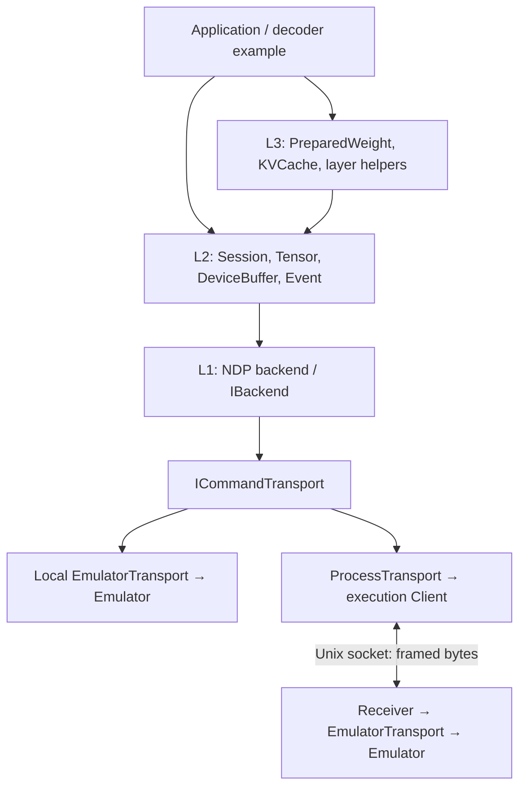

# Data flow across library layers

This document describes the **implemented C++ library**, focusing on memory
allocation, transfers, command submission and completion. It covers both the
local command emulator (`make_ndp_backend`) and the process backend
(`make_gem5_backend`) validated through F5. It does not describe a hypothetical
FPGA driver or a PNM/PIM gem5 device interface.

## 1. Layers and process boundaries



L2 and L3 are actual source/API divisions, not separate processes. The public
`Session` API resides in L2; L3 contains model-oriented composition. Backend and
transport also normally run in the application's process. Only the process
backend adds a receiver process. Under stock gem5 FS, **both processes run inside
the Linux guest**; the socket does not cross from the host machine into gem5.

The emulator is the current execution implementation. PNM compute uses functional
kernels, not an executing RISC-V ELF engine. Commands are private semantic objects,
not native AiM binary instructions. No DMA driver, MMIO doorbell or dedicated
hardware completion queue exists in this path.

The functional reference backend implements `IBackend` using in-memory
execution directly. The command lowering and IPC sections below apply to the NDP
command backend and its process transport, not to every backend automatically.

## 2. What crosses each boundary?

| Boundary | Request data | Return data | Representation |
| --- | --- | --- | --- |
| Application/L3 → L2 | Tensor/DeviceBuffer references, `TensorDesc`, `OpOptions`, operation attributes, host bytes | `Result<Tensor>`, `Result<DeviceBuffer>`, `Result<Event>`, `HostTransfer`, or host result | C++ objects in the same process |
| L2 → L1 metadata query | `TensorDesc` or `OperationSpec` | `LayoutDesc` or `KernelPlan` | C++ metadata; no device execution |
| L2 worker → L1 execution | Byte count, allocation handles, byte spans, layouts, or `KernelPlan` | Handle or `Result<void>` | Blocking C++ method call |
| NDP backend → transport | `Address` + byte span, or `span<const Command>` | `Result<void>` after completion | Semantic C++ objects |
| Process client → receiver | Hello, Upload, Download, Submit or Close payload | Completion/error frame, optionally output bytes | Explicit serialized bytes over a Unix socket |
| Receiver → emulator | Decoded address/byte span or command vector | Bytes or completed status | C++ call; same semantics as local transport |
| L2 → caller after execution | Event state/error; downloaded `HostTensor` when requested | `Succeeded`/`Failed`, `Status`, or host bytes | Host-side objects, not device addresses |

A `Tensor`, `DeviceBuffer`, `BufferLease`, `AllocationHandle`, `KernelPlan` or
C++ pointer is **not serialized wholesale** into IPC. The NDP backend consumes
handles and plans, then passes the required addresses and command fields downward.

### Objects that are easy to confuse

| Object | Content and purpose | Owner / scope |
| --- | --- | --- |
| `TensorDesc` | Logical shape and dtype; normal data is FP16 | Shared logical metadata |
| `LayoutDesc` | Logical description, layout kind, physical byte size, alignment, format/version string | Backend defines; L2 retains per representation |
| `Tensor` | Shared reference to a record with a map of representations | Public L2 immutable logical tensor |
| `Representation` | `LayoutDesc` + buffer lease + readiness Event | Private L2; one materialized copy/layout |
| `DeviceBuffer` | Dense mutable storage description, lease, allocation and last-write Events | Public L2; used by L3 KVCache |
| `BufferLease` | Byte budget, optional allocation handle and backend resource ownership | Private L2 lifetime management |
| `AllocationHandle` | Opaque `uint64_t` key | L1 allocation table; not a pointer/address |
| `Region` | First row and requested byte count | Private NDP backend allocation record |
| `Address` | `{Space, uint64_t offset}`; offset is in bytes | Transport/emulator address, not a host pointer |
| `OperationSpec` | Operation kind, engine, input descriptions and attributes | Logical planning request |
| `KernelPlan` | Operation, kernel ID, input/output layouts, workspace, tile size and accumulator dtype | Backend supplies; L2 validates and retains |
| `Command` | Variant of transfer, PIM, PNM, copy/fill commands | Lowered execution representation |
| `Event` | Host status and optional error, mutex/condition variable | L2 completion observation |

`PreparedWeight` and `KVCache` are L3 objects. They call generic L2 APIs; neither
is a special device allocation or a distinct wire message type.

## 3. Memory allocation and release

### 3.1 Public request → L2 reservation

For mutable storage:

```cpp
auto buffer = session.allocate(TensorDesc{{128, 64}, DType::F16});
```

For an immutable tensor, `from_host()` allocates its initial dense representation;
compute allocates its output, and layout materialization allocates an additional
representation. The caller does not pass a device address.

L2 computes the required byte count and reserves it in `MemoryStats` through a
`BufferLease`. At this point the lease may have **no allocation handle yet**.
The FIFO worker later calls `IBackend::allocate(bytes)` and stores its returned
handle in the lease. Successful API submission therefore does not prove that
backend allocation has completed. The object's Event reports eventual failure.

`Session::allocate()` additionally queues zero initialization through `fill`.
The bare backend `allocate()` is not a zero-fill command. Upload allocations are
subsequently written with the supplied data instead.

### 3.2 L2 → NDP allocation table

```text
L2 worker: allocate(requested_bytes)
    ↓
NDP backend: reserve contiguous row stripes
    regions_[handle] = Region{first_row, requested_bytes}
    ↓
return AllocationHandle (uint64_t)
```

For the current command backend:

```text
stripe_bytes = channels × banks × row_bytes
reserved_row_count = ceil(requested_bytes / stripe_bytes)
shared_offset = first_row × stripe_bytes + byte_offset_within_region
```

Row zero is reserved for immutable zero data used by PIM command sequences.
Allocations use subsequent rows. The handle-to-region map stays in the application
process. **There is no Allocate/Free IPC opcode.** The emulator allocates its
configured Shared/GPR/scratchpad storage when it is created; backend allocation
subdivides that storage logically.

For example, with 2 channels, 2 banks and 64-byte rows, one stripe is 256 bytes.
A region starting at row 3 maps to `Address{Shared, 768}`. Its allocation handle
might be any valid table key; it does not equal 768 and is not transmitted as 768
without the backend's explicit lookup.

L2 counts requested representation bytes; the NDP allocator consumes whole row
stripes. Consequently, row rounding/fragmentation can cause backend allocation
failure even when L2's byte budget has room. `MemoryStats` is not a measurement
of all emulator process memory or allocator rounding overhead.

### 3.3 Scratchpad and lifetime

Kernel scratchpad is managed separately through `reserve_workspace(bytes)`.
L2 reserves the backend's reported scratchpad arena when a plan first requires
workspace. In the current NDP backend this call checks capacity; scratchpad
storage already exists in the emulator. It is not a normal Shared allocation
and sends no new allocation message.

Queued tasks retain buffer leases, so dropping a user Tensor does not release
storage still needed by queued work. The last lease calls `release(handle)`;
the NDP backend removes its region entry and marks rows reusable. Release is
host bookkeeping, sends no IPC and does not erase the old bytes. It remains valid
for handles destroyed after Session close.

## 4. Data delivery

### 4.1 Host → device upload

```text
HostTensorView { TensorDesc, span<const byte> }
  → Session validates shape/dtype/byte count
  → owned staging vector<byte> copied before from_host() returns
  → queued task retains staging and destination BufferLease
  → backend.allocate(bytes) → handle
  → backend.upload(handle, span<const byte>)
  → lookup Region → Address{Shared, offset}
  → transport.upload(Address, bytes)
  → emulator writes its configured memory
```

The input view is borrowed only during the public call. L2's staging copy allows
the caller's original memory to go out of scope while execution is pending.
`HostTensorView::bytes` contains FP16 binary16 values as native-endian 16-bit words;
upload/download perform no implicit FP32 conversion. The transport treats these
as raw bytes. Protocol scalar fields are explicitly little-endian, but tensor
payloads are not separately byte-swapped. Current native/FS paths use compatible
little-endian hosts; cross-endian tensor interoperability is not established.

For the local transport, the address/span are passed directly to the emulator.
For the process transport, Upload carries address-space ID, byte offset, byte
count and an actual copy of those bytes in the socket payload. No host pointer
is passed to the receiver.

### 4.2 Device → device copy and fill

`Session::copy_into()` receives `TensorCopy` records containing source Tensor,
destination DeviceBuffer, source/destination offsets and count. These public
units are **FP16 elements**. L2 validates bounds and dependencies, then converts
them to byte offsets/counts for:

```text
IBackend::copy_region(source_handle, source_byte_offset,
                     destination_handle, destination_byte_offset, byte_count)
  → CopyBytes{source Address, destination Address, byte_count}
  → transport.submit(command batch)
```

`clear()` and initial mutable-buffer initialization similarly become
`fill(handle, byte{0})` → `FillBytes{Address, bytes, value}`. A fill value is a
byte pattern, not an FP16 numeric scalar. Copy/fill transfer commands, not Tensor
data via host memory. A snapshot allocates independent dense Tensor storage and
copies the selected buffer region; it is not a mutable alias.

### 4.3 Layout materialization

```text
Tensor + target LayoutDesc
  → L2 checks/reuses a matching representation, or reserves a new BufferLease
  → waits for source representation
  → backend.transform(source_handle, source_layout, dest_handle, dest_layout)
  → PnmRelayout{source/dest Address, rows, columns, banks,
                tile_elements, row_bytes, pack}
  → emulator transforms actual data
```

The original dense representation remains available. A materialized layout is a
real additional device-side representation, not just a changed layout tag.
`PimBanked` weights include padding and use a geometry-specific format string.
The receiver gets the relayout command's required dimensions/mapping parameters;
it does not reconstruct a `Tensor` or query a `KernelPlan`.

For this backend, PIM GEMV **outputs are dense Shared memory**. Subsequent PNM
operations can consume them directly. Weight packing is needed for the PIM input
requirements; a PIM→PNM engine change alone does not imply output relayout.

## 5. Delivering an operation

### 5.1 Logical operation → validated plan

For example:

```cpp
auto y = session.matvec(weight, vector, {Engine::PIM});
```

L2 constructs an `OperationSpec` with `Matvec`, `PIM`, the two input descriptions
and attributes. `Planner::build()` infers output semantics, calls
`IBackend::query_operation()` and checks the returned `KernelPlan`, canonical
layouts, accumulator and workspace against the contract. Planning runs on the
submission thread and does not execute commands or transfer input data.

Thus the responsibility split is precise: **L1 supplies backend-specific plan
metadata; L2 validates it and schedules the required representations.** L2 does
not independently invent the device's bank geometry, and the receiver does not
repeat this planning step. The NDP backend revalidates the plan on execution.

`OpOptions.engine` selects the requested implementation for this operation.
`layout_policy` controls whether missing input layouts can be materialized or
must already be prepared. Neither option is a Session-wide engine switch.

### 5.2 Queued work → blocking backend call

L2 retains the plan, input representations, dependencies and output lease in a
host closure. This private L2 `Command` is a scheduled task containing an Event,
dependencies and a C++ function. It is distinct from the L1 semantic `Command`
variant and is never serialized.

After input Events succeed, the worker reserves workspace if needed, allocates
the output and calls:

```cpp
backend.execute(plan, input_allocation_handles, output_allocation_handle);
```

L1 resolves handles into Regions, validates their sizes and builds the command
sequence. Engine selection has now been lowered into concrete command types.

### 5.3 PNM lowering

A supported PNM operation becomes `PnmCompute` with:

- Kernel ID (`Matmul`, `Add`, `Mul`, `RMSNorm`, `Softmax`, `SiLU`, etc.).
- Input/output `Operand` records: address plus FP16 element count.
- Required dimensions (`rows`, `width`, `inner`), transpose flag, factor/epsilon,
  and indices for operations that need them.

The shape information in these scalar fields is execution metadata derived from
the plan, not a second copy of the entire Tensor/runtime object graph. The current
emulator executes the functional kernel. `LaunchPnmProgram` is a separate command
contract; ordinary Session compute does not currently generate executable ELF
programs or route through a RISC-V executor.

### 5.4 PIM GEMV lowering

For PIM, the current backend supports `Matvec` and bias-free single-row `Linear`.
`build_matvec()` emits a sequence of:

1. Transfer zero values from reserved Shared row zero into GPR.
2. `InitializeMac` for the output-bank group.
3. For each input tile: clear GPR lanes, transfer input bytes Shared→GPR,
   one GPR→GB Transfer per channel, then `MacAllBanks` using weight row/column/burst fields.
4. `ReadMac` into GPR, then Transfer GPR→dense Shared output.

Channel/bank fields are masks; row/column and burst counts are device-command
coordinates, not allocation handles. MAC state accumulates across input tiles.
The final Transfer makes the result available to the next operation. Submit
completion does not itself carry the GEMV output values back to the host.

## 6. Process transport: the actual transmitted bytes

Only `make_gem5_backend()` uses this wire path. `ProcessTransport` owns the socket,
receiver PID and execution client. Calls remain synchronous and serialized by
the existing worker: one exchange at a time, without another scheduling queue.

### Outer frame

Each frame is a 32-byte header followed by payload bytes:

| Offset | Field | Width |
| --- | --- | --- |
| 0 | Magic `NIP1` | 4 bytes |
| 4 | Frame version = 1 | u16 |
| 6 | Kind: ExecuteRequest=4, ExecuteComplete=5, ExecuteError=6 | u16 |
| 8 | Connection epoch | u64 |
| 16 | Request sequence | u64 |
| 24 | Payload byte count | u32 |
| 28 | Payload CRC32 | u32 |

All integer header fields are little-endian. The client validates response
kind, epoch, sequence, operation and expected size. F2 metadata `Accepted` is
not a valid execution completion. Framing handles partial socket reads/writes;
a socket frame is not one gem5 memory Packet.

### Request and response payloads

| Operation | Request payload | Successful response payload |
| --- | --- | --- |
| Hello=1 | op:u8, codec version:u16, FP16 profile:u16, mapping ID:u16, seven geometry values:u64 | Exact Hello echo after validation/emulator creation |
| Upload=2 | op:u8, space:u8, offset:u64, count:u64, raw bytes | op:u8 |
| Download=3 | op:u8, space:u8, offset:u64, count:u64 | op:u8 + raw bytes |
| Submit=4 | op:u8 + encoded `NDP1` command batch | op:u8 |
| Close=5 | op:u8 | op:u8 after emulator teardown |

Geometry order is channels, banks, rows, row_bytes, gb_bytes, gpr_bytes,
scratchpad_bytes. Address-space IDs are Shared=1, Gpr=2, Scratchpad=3.
Global Buffer is addressed by its specific load command, not a fourth generic
address-space ID. Mapping ID 1 denotes `[row][channel][bank][byte]`.

Submit uses the F1 codec: a 16-byte `NDP1` header (magic, version, FP16 profile,
total length and command count), followed by records with opcode:u16,
reserved:u16, record length:u32 and explicitly encoded fields. Size/count fields
use fixed-width wire types, not raw native `size_t`; variants, STL containers
and padding are not copied to the socket. See [the codec contract](command-transport.md)
for its schema and [execution protocol](gem5-f3.md) for error details.

An error response contains op:u8, error ID:u16 and up to 256 message bytes.
Wire error IDs distinguish InvalidArgument, UnsupportedOperation, OutOfMemory
and BackendFailure; other backend errors map to BackendFailure on this boundary.
Payload size is capped at 8 MiB. Upload data is limited to that minus 18 bytes,
download data to that minus one, and encoded Submit batches to that minus one.
Large requests are rejected rather than automatically chunked across frames.

## 7. Checking completion and retrieving results

### 7.1 Execution completion is not output download

```text
Receiver finishes operation and memory writes
  → ExecuteComplete response
  → client validates response → transport returns Result<void>
  → NDP backend returns → L2 worker releases task-owned temporary references
  → Event becomes Succeeded (or Failed with Status)
  → Tensor::wait() / Event::wait() wakes the caller
```

The local backend follows the same path without socket serialization: emulator
method return supplies the synchronous completion boundary. The emulator checks
command-batch validity before execution. L1 methods must not return—even on
failure—while accesses covered by the call remain active.

L2's public submission is asynchronous, but its worker invokes a blocking L1
operation. There is no separate public per-device poll command. `Event::status()`
reads host state; `wait()` uses a condition variable. Checking a Tensor's readiness
does not download its bytes or issue repeated device status requests.

Submission errors (invalid shape, unsupported engine/layout, etc.) can return
immediately as a failed `Result<Tensor>`. Execution/allocation failures can occur
later and appear in the returned Tensor/Event. Callers must check both.
A failed dependency produces `DependencyFailed`; the dependent backend operation
is skipped. Session synchronize/close also report recorded execution failures.

### 7.2 Explicit result readback

```text
session.to_host_async(tensor)
  → HostTransfer { Event, owned HostTensor output }
  → worker waits for source readiness
  → backend.download(handle, mutable byte span)
  → transport.download(Address, span)
  → Download response contains actual data bytes
  → complete response validated, then copied into host output
  → HostTransfer::wait() returns Result<HostTensor>
```

`HostTensor` contains the logical `TensorDesc` and dense raw FP16 byte vector.
`to_host()` is the blocking convenience form. If a packed source representation
is explicitly selected, L2 allocates a temporary dense region, transforms that
selected source and downloads the dense result. It does not substitute the
original cached dense tensor for the selected packed source.

### 7.3 Faults and close

A matching execution error means the request has finished unsuccessfully; the
connection can remain usable. Timeout, disconnect or invalid completion leave
execution uncertain. The process transport terminates and reaps its owned
software receiver **before** returning failure, then rejects further I/O. It
never blindly reconnects or replays the request. Download updates the caller's
span only after a complete validated response.

Session close stops new submissions, drains queued work, joins its worker and
calls backend shutdown. The process transport sends Close, reaps the receiver
and closes its socket; surviving leases can later release their host allocation
records. A future independently executing hardware device would need its own
quiescence guarantee—killing a forwarding process alone would not provide it.

## 8. Source map

| Topic | Source |
| --- | --- |
| Public Session objects and transfer API | [session.hpp](../include/ndp/l2/session.hpp) |
| Leases, FIFO tasks, planning, upload/download, Events | [session.cpp](../src/l2/session.cpp) |
| Plan validation | [planner.hpp](../src/l2/planner.hpp) |
| Blocking backend contract | [backend.hpp](../include/ndp/l1/backend.hpp) |
| NDP allocation map, transform and execute | [NDP backend](../src/l1/ndp/backend.cpp) |
| Address calculation and PNM/PIM lowering | [command_builder.cpp](../src/l1/ndp/command_builder.cpp) |
| Semantic command fields | [command.hpp](../src/l1/ndp/command.hpp) |
| Local transport and emulator | [transport.cpp](../src/l1/ndp/transport.cpp), [emulator.cpp](../src/l1/ndp/emulator.cpp) |
| Command serialization | [codec.cpp](../src/l1/ndp/codec.cpp) |
| Process ownership and failure cleanup | [process backend](../src/l1/gem5/backend.cpp) |
| Execution requests/responses and receiver | [execution.cpp](../src/l1/gem5/execution.cpp) |
| Socket framing | [metadata.cpp](../src/l1/gem5/metadata.cpp) |
| Explicit decoder using this path | [decoder_probe.cpp](../tools/gem5/guest/decoder_probe.cpp) |
