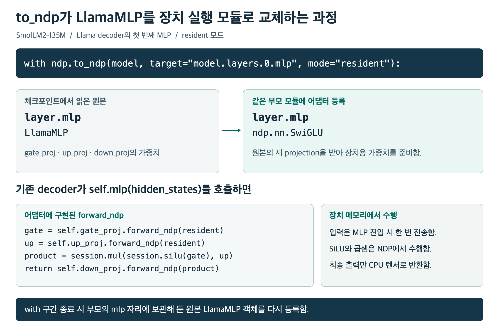
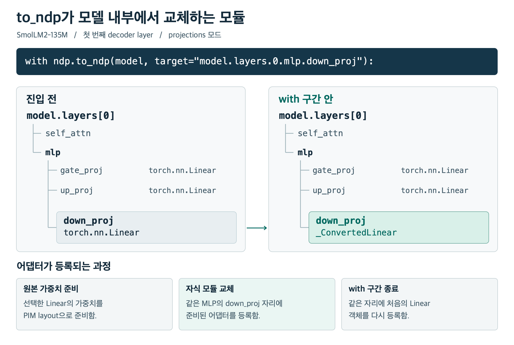
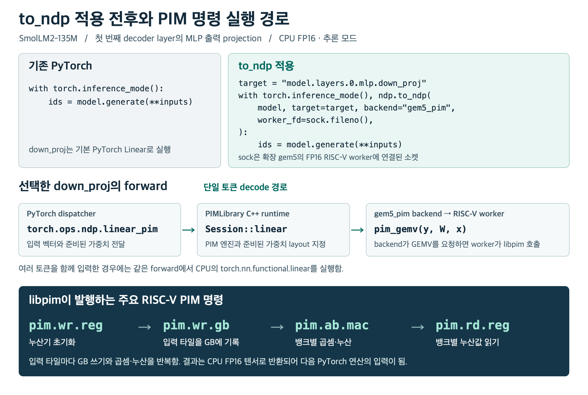

# PIMLibrary의 PyTorch 확장 및 Hugging Face Transformers 연동

Hugging Face Transformers에서 불러온 모델의 가중치와 토큰 생성 절차를 활용하기 위해, 지원하는 모듈을 추론 시점에 PIMLibrary 어댑터로 교체하는 PyTorch 확장을 구현함. 라이브러리는 모듈 유형별로 **어떤 구조를 교체할 수 있는지 판별하는 규칙**과 **같은 계산을 PIM·NDP 연산으로 수행하는 어댑터**를 제공함. 체크포인트를 불러올 때마다 해당 모델의 가중치와 차원으로 어댑터 인스턴스를 생성하므로, 같은 구조를 갖는 여러 체크포인트에 하나의 구현을 재사용할 수 있음.

## 1) 모델 구조에 따른 어댑터 선택과 교체

SmolLM2-135M을 예로 들면, 먼저 Transformers의 `LlamaForCausalLM.from_pretrained`로 체크포인트를 CPU FP16 형식으로 불러오고 `eval()`로 추론 모드를 설정함. 이후 `to_ndp`에 `target="model.layers.0.mlp"`와 `mode="resident"`를 지정하면 첫 번째 decoder의 MLP가 교체 대상이 됨. 모델 전체의 실행은 기존 `generate()`가 담당하고, decoder가 `self.mlp(hidden_states)`를 호출하는 지점부터 어댑터의 코드가 실행됨.

**[그림 1] 체크포인트의 가중치로 생성한 MLP 어댑터의 등록 및 실행 과정**

- **지원 구조 확인**
  - `to_ndp`는 `named_modules`로 지정한 경로의 모듈을 찾고, 모듈 유형과 내부 구성이 라이브러리의 교체 규칙에 맞는지 검사함. 현재 MLP 규칙은 Transformers 4.57.6의 기본 `LlamaMLP`를 대상으로 하며, SiLU 활성화 함수와 bias 없는 gate·up·down projection의 가중치 형상을 확인함. 사용자 정의 `forward`, 실행 hook 또는 공유 가중치가 있어 교체 시 동작이 달라질 수 있는 모듈은 제외함. `ndp.plan_to_ndp`로 세션을 열기 전에 적용할 규칙과 제외 사유를 조회할 수 있음.

- **가중치 준비 및 자식 모듈 교체**
  - MLP 규칙이 일치하면 원본 객체의 `gate_proj`, `up_proj`, `down_proj`를 가져와 `ndp.nn.SwiGLU`의 생성자에 전달함. 어댑터는 각 projection의 가중치를 장치로 전송하고 prefill과 decode에 필요한 layout을 준비함. 준비가 완료되면 부모 decoder의 자식 모듈 등록 항목인 `_modules["mlp"]`에 새 객체를 대입함. 이 한 번의 교체로 부모의 기존 호출이 새 `forward`를 실행함. `with` 구간이 끝나거나 추론 중 예외가 발생하면 같은 자리에 보관해 둔 원본 객체를 복원함.

- **교체된 MLP의 실행**
  - `SwiGLU.forward`는 CPU 텐서로 받은 hidden state를 한 번 전송하고, 장치 텐서를 `forward_ndp`에 전달함. 이 함수에는 gate·up projection, SiLU, 원소별 곱셈, down projection의 순서가 구현되어 있음. Projection은 입력이 한 행이면 PIM GEMV로, 여러 행이면 NDP GEMM으로 수행함. SiLU와 곱셈은 NDP에서 수행하며 중간값은 장치에 유지함. 마지막 projection의 결과만 CPU 텐서로 반환하므로 다음 Transformers 모듈은 기존 방식으로 계산을 이어감.

## 2) PyTorch dispatcher 등록과 C++ runtime 호출

모델에서 어떤 모듈을 교체할지는 Python의 `to_ndp`가 결정함. **PyTorch dispatcher 자체의 코드는 수정하지 않았으며**, 확장이 제공하는 두 연산만 PyTorch의 기존 등록 인터페이스로 추가함. 어댑터가 장치 텐서를 직접 다루는 경우에는 Python 바인딩을 통해 C++ runtime을 호출함.

- **장치 텐서로 수행하는 복합 연산**
  - 그림 1의 MLP에서 `session.mul(session.silu(gate), up)`을 호출하면 Python 바인딩이 각 텐서가 해당 세션에 속하는지 확인하고 장치 텐서 핸들을 C++ `Session::silu`와 `Session::mul`에 전달함. 두 함수가 반환한 핸들은 다음 연산의 입력으로 사용됨. 이 과정에서 NDP 실행을 지정하는 주체는 어댑터이며, PyTorch가 기존 `aten::silu`나 `aten::mul`의 실행 장치를 다시 선택하는 절차는 없음.

- **CPU 텐서를 입력받는 custom operator**
  - 개별 projection을 적용하는 경로에서는 C++ 확장이 `TORCH_LIBRARY(ndp, m)`으로 `ndp::linear_pim`과 `ndp::qkv_pim`의 호출 규격을 선언하고, `TORCH_LIBRARY_IMPL(ndp, CPU, m)`으로 CPU 텐서 입력을 처리할 함수를 등록함. 여기서 CPU dispatch key는 **입력 텐서가 있는 위치**를 뜻함. 등록한 함수는 입력을 장치로 전송하고 미리 준비한 가중치로 C++ runtime에 PIM 연산을 요청한 뒤 결과를 CPU 텐서로 반환함.
  - 기본 `projections` 모드에서 선택한 Linear의 어댑터는 입력 벡터가 하나일 때 `torch.ops.ndp.linear_pim`을 호출함. 입력이 여러 벡터이면 CPU의 `torch.nn.functional.linear`를 사용함. 지원하는 Llama eager attention에서 Q/K/V 세 projection을 함께 선택하면 `qkv_pim`이 입력을 한 번 전송해 세 연산에 재사용함. 이 등록의 적용 범위는 어댑터가 명시적으로 호출한 연산이며, 일반 PyTorch 모듈의 Linear, SiLU, 곱셈은 기존 ATen 경로를 따름.

  

  **[그림 2] 개별 projection을 선택한 경우의 모듈 구성**

  

  **[그림 3] 개별 projection의 custom operator 호출과 PIM 명령 실행 경로**

  - 그림 3은 `gem5_pim` backend와 확장 gem5의 FP16 RISC-V worker를 사용한 경우임. `down_proj`에 들어온 1,536개 입력 특성이 `linear_pim`을 거쳐 C++ `Session::linear`에 전달됨. Worker가 libpim의 `pim_gemv`를 호출하면 입력 타일별로 global buffer를 채우고 `pim.ab.mac`으로 뱅크별 내적을 누산함. 최종 출력은 576개 특성의 CPU FP16 텐서로 반환됨.

## 3) Decoder 및 다중 장치 실행으로의 확장

- **Decoder 어댑터와 Transformers의 KV cache 연동**
  - `resident` 모드로 Llama decoder 하나를 지정하면 정규화, RoPE, grouped-query attention, SwiGLU 및 residual 덧셈을 포함하는 어댑터로 교체함. 해당 decoder의 K/V는 요청별 장치 버퍼에 유지하고 Transformers의 `DynamicCache`에 누적 길이를 제공함. 현재 이 경로는 Transformers 4.57.6의 eager attention과 기본 RoPE를 사용하는 패딩 없는 단일 시퀀스를 대상으로 하며, 연속된 토큰 위치에서 기존 모델의 `forward`와 greedy `generate()`를 지원함.

- **다중 장치 모델 구성**
  - 전체 decoder를 여러 장치에 배치할 때는 원본 Llama 모델로 `ndp.nn.TensorParallelLlamaForCausalLM`을 구성함. 이 어댑터는 projection 가중치를 장치별로 나누거나 연속된 decoder를 장치 그룹에 배치하고, 자체 greedy 생성 루프로 추론을 진행함. Embedding과 LM head는 CPU에서, decoder와 최종 RMSNorm은 장치에서 수행함.
